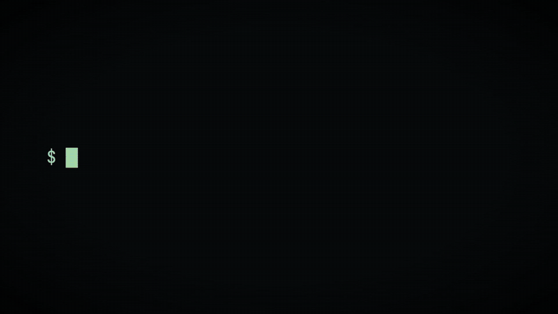
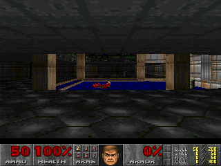

# DOOM on Qwenputer

**The first Doom frame rendered by a CPU compiled into a language model's weights.**

[Qwenputer](https://github.com/divagr18/qwenputer) is Qwen3.5-4B with a 32-bit RISC-V CPU compiled directly into its weights. No CPU weight is learned. A compiler sets every one of them, and the model's Gated DeltaNet state works as RAM. I compiled Doom E1M1 to RV32IM firmware and ran it through Qwenputer's compiled CPU circuit on an RTX 5070 Ti. The circuit generated all 6,342,933 trace tokens itself, and every one of them matched an independent reference CPU.

*Footage is the real live GPU capture, sped up 240×. Checkerboard marks pixels the circuit hasn't produced yet.*

## The result

| | |
| --- | --- |
| Tokens generated by the circuit | **6,342,933** |
| Mismatches against the reference CPU | **0** |
| Strips read back from the circuit's recurrent GPU RAM | **25 / 25** (all 320 × 240 pixels) |
| Generation time | **50.7 min** on one RTX 5070 Ti (16 GB) |
| Guest machine | RV32IM, 64 KiB RAM, 4 MiB data ROM |

The final frame bytes and all 65,536 bytes of final RAM match the independently executed reference exactly.

## How it works

1. **Doom → RISC-V.** Artur Bieniek's [DMC100-Doom](https://github.com/ArturBieniek4/DMC100-Doom) is a strip-rendering Doom designed for tiny microcontrollers. It draws the screen in 25 small strips instead of holding a full framebuffer, so E1M1 fits in 64 KiB of RAM. I built atc1441's [Aspire PIXO vape port](https://github.com/atc1441/Vape_DOOM_ScreenShare/tree/main/PixoAspire_DOOM_Port) of it as bare-metal RV32IM firmware.
2. **Firmware → tokens.** Qwenputer runs the CPU as next-token generation. Each generated token feeds the next step, so the run is 6,342,933 self-generated trace tokens.
3. **Tokens → GPU.** The compiled CPU layers run on Qwenputer's compact Triton circuit executor, using fp32 circuit arithmetic and CUDA graphs.
4. **RAM → pixels.** At each strip boundary the runner reads the strip, its descriptor and the palette straight out of the circuit's own recurrent state. No reference pixels are used. Python only arranges the strips and converts RGB565 to PNG.

## What this is, and isn't

- This is one verified frame. It is not interactive gameplay.
- It runs on the compact Triton circuit executor, which executes the compiled CPU layers. It is not stock Hugging Face inference, and the pretrained Qwen language layers were not loaded.
- 50.7 minutes is GPU generation time, not end-to-end wall-clock time. The run resumed once from a saved GPU checkpoint after a Windows file error.

## Reproduce it

Everything needed to rerun the experiment is in this repo, except the game data: you supply your own shareware `DOOM1.WAD`. **[REPRODUCE.md](REPRODUCE.md)** walks through it step by step, from setup to checking the final hashes.

| Step | Directory | What it does |
| --- | --- | --- |
| 1 | [`experiments/memory-map`](experiments/memory-map/README.md) | Grows the compiled CPU from 32 KiB to 64 KiB RAM and 4 MiB DROM, and proves the new map |
| 2 | [`experiments/memory-map-cuda`](experiments/memory-map-cuda/README.md) | Repeats the memory proof on the GPU and reads RAM back from the circuit state |
| 3 | [`experiments/dmc-rv32`](experiments/dmc-rv32/README.md) | Ports DMC100-Doom's strip renderer to Qwenputer and runs it on the reference CPU |
| 4 | [`experiments/doom-baremetal`](experiments/doom-baremetal/README.md) | The libc subset the port links against, plus the stock Doomgeneric comparison (51M tokens) |
| 5 | [`experiments/dmc-cuda`](experiments/dmc-cuda/README.md) | The GPU runner, checkpointing and strip capture, with the recorded run's evidence |
| | [`experiments/gpu-setup`](experiments/gpu-setup/README.md) | Windows CUDA and Triton environment for the GPU steps |

Divyansh's write-up explains how Qwenputer works: [divagr.com/blog/qwenputer](https://divagr.com/blog/qwenputer).

## Credits

- **Qwenputer** by Divyansh Agrawal: [github.com/divagr18/qwenputer](https://github.com/divagr18/qwenputer)
- **[DMC100-Doom](https://github.com/ArturBieniek4/DMC100-Doom)** by Artur Bieniek, and the **[Aspire PIXO port](https://github.com/atc1441/Vape_DOOM_ScreenShare/tree/main/PixoAspire_DOOM_Port)** by atc1441
- **DOOM** © id Software. The frame shows shareware E1M1. No WAD or game data is distributed here.

New code is MIT licensed (see [LICENSE](LICENSE)). The DMC platform adaptation keeps GPL-2.0-or-later; see [THIRD_PARTY_NOTICES.md](THIRD_PARTY_NOTICES.md). The Doom imagery in `media/` and `video/public/` belongs to its respective owners.
