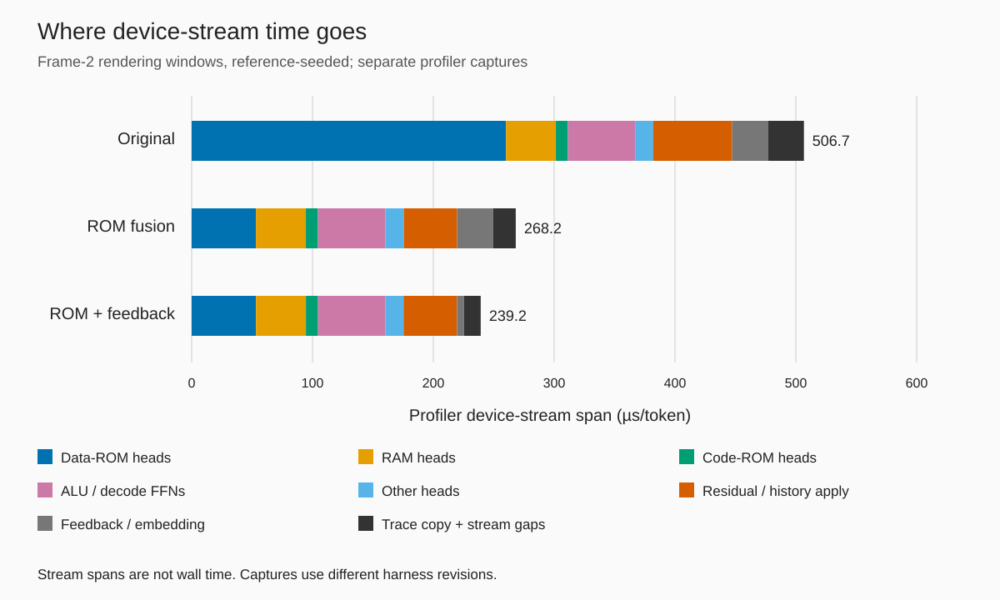
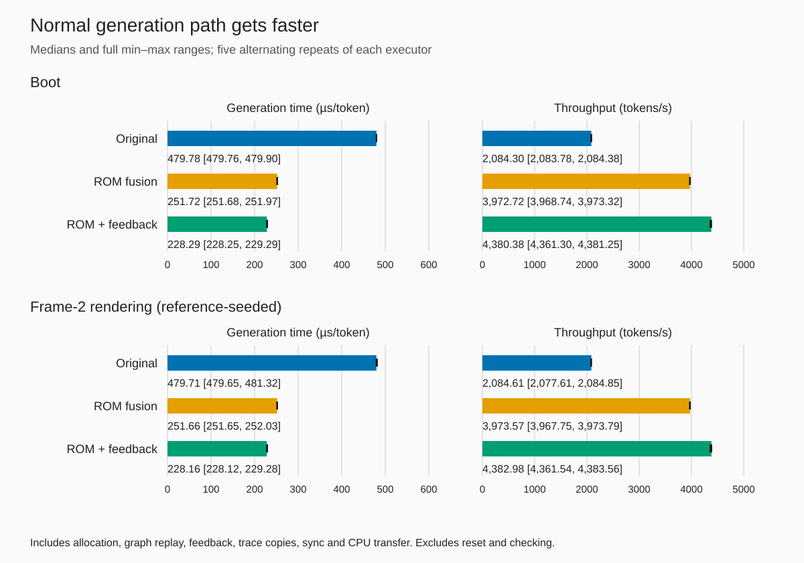
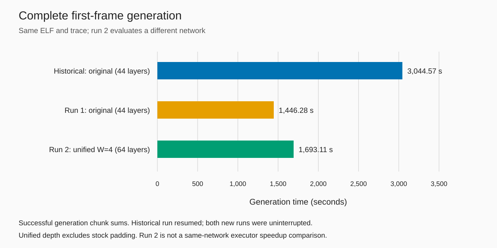
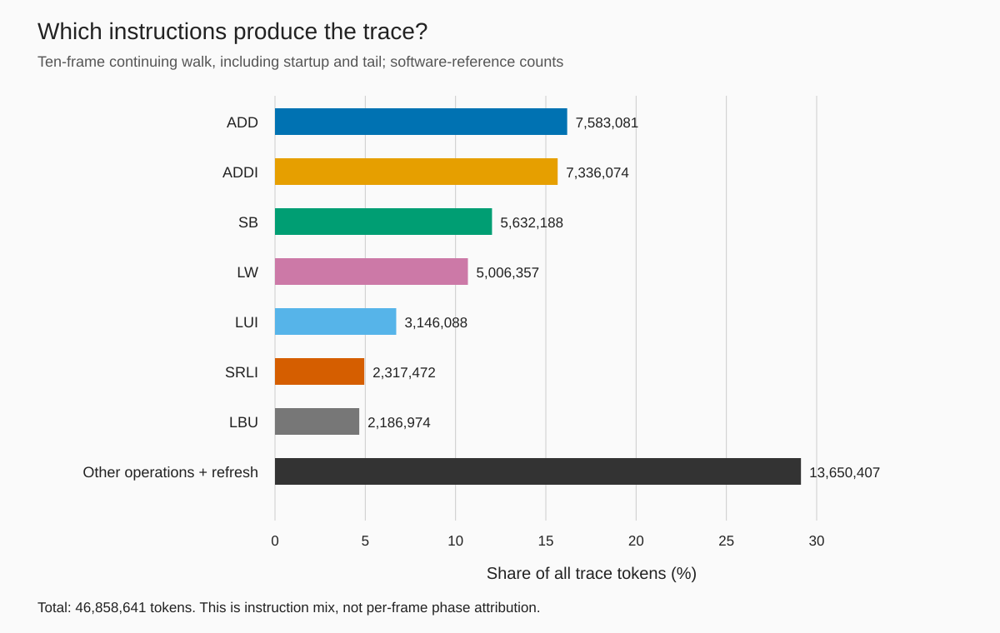
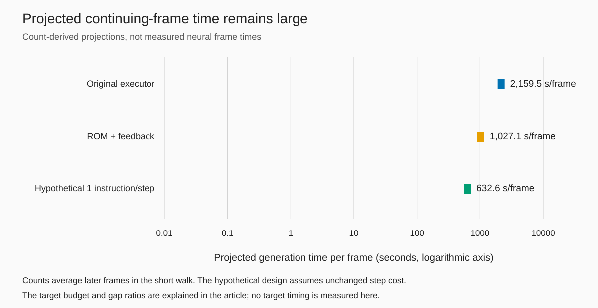

# Doom on a CPU compiled into Qwen layers

<!-- Numeric provenance is in SOURCES.md. Game imagery remains private. -->

We ran a Doom port through a RISC-V CPU defined by fixed neural weights. The network generated the execution trace, fed its own output back into its next input, and produced the memory from which we extracted a frame. The GPU evaluated the circuit. It did not run a separate Doom renderer or a native RISC-V interpreter.

The first frame required 6,342,933 trace tokens. On the original circuit, generation took 3,044.6 historical retained seconds versus 1,446.28 seconds with fusion, an observed 2.105× historical generation-time ratio on the same ELF, circuit, and token trace. The historical run was interrupted and began from warm-up histories. The ratio is consistent with the controlled alternating-window results below, which provide better evidence for the fusion effect. The new run took 1,469.41 seconds including setup and observation. A second complete run used the unified network shared by the other demos. Both reached `HALT` with every token matching an independent reference.

A neural CPU can execute this workload, but the current representation spends much of its time evaluating memory heads and transporting instruction results between neural steps. Optimizing those operations reduces frame time while leaving a large gap to interactive rendering.

## What runs inside Qwenputer

Qwenputer compiles an RV32IM CPU into fixed weights for Qwen3.5 layers. This is a constructed circuit, not a pretrained language model learning to imitate instruction execution. Program and data images initialize machine state. The weights define the supported machine operations and remain independent of the guest program. The expanded standalone machine also supports the Zba address-generation extension used by this port.

The circuit implements arithmetic, register access, memory access, and control flow through neural operations and recurrent tables. The existing code image is predecoded during preparation, as described in the [one-instruction design investigation](../../experiments/one-instr-design/DESIGN.md). That qualification matters when describing the CPU. This experiment does not establish a new raw-instruction decoder inside the weights.

An execution trace is also the machine's feedback protocol. Each output token belongs to a family and may carry a numeric payload. `F0`, `F1`, and `F2` finish value records of different widths. `V` carries a nonfinal value chunk. `J` carries a jump destination, and `R` refreshes the PC anchor. Store controls commit memory changes. `BYTE` carries output events, and `HALT` ends execution.

One instruction need not correspond to one token. A small register result can fit in a single final token. A larger result can require preceding value chunks. Byte and halfword stores serialize a merged word before the store control. Division has its own intermediate records. These tokens are internal CPU transport as well as an observable trace. Suppressing a trace file would not eliminate the transitions that use it.

The current token commits the preceding predicted operation while the circuit computes the next token. That output determines the next embedding. This recurrence is essential to the claim that the network executes the program. Feeding reference tokens into every step would test predictions under a supplied trace, rather than demonstrate self-fed execution.

There are two execution paths in this project's history. The stock Hugging Face checks instantiate compiled fixed weights in Qwen3.5 model layers and use ordinary cached generation. They load no pretrained language-model weights. Earlier CHIP-8 work established small prefixes and a complete frame through that path. Separate compact executors evaluated the sparse circuit directly, first on the CPU and later through Triton kernels on CUDA.

Doom uses the compact fp32 Triton circuit executor. Its CUDA graph evaluates the circuit, decodes the output token, and constructs the next embedding on the GPU. The verification record separates evidence for this executor from the stock-model checks.

## Getting Doom into the machine

The first obstacle was writable memory. The [initial Doomgeneric audit](../doom-feasibility.md) found allocations that did not fit the released memory map. Enlarging the output window or removing a format conversion would not solve the renderer's underlying storage requirement. We needed a port organized around a smaller working set.

The DMC engine, adapted through the supplied PIXO port, renders narrow strips and streams game records. The Qwenputer platform glue replaces the board-specific interfaces with bare-metal RV startup, deterministic time, memory-mapped data reads, and output markers. The engine performs the rendering. The first-frame workload has idle input and disabled audio. It is a bounded E1M1 experiment, with no claim about menus, saving, later levels, or long sessions.

The expanded memory map provides 64 KiB of writable RAM at `0x01000000`, 4 MiB of read-only data ROM at `0x02000000`, and the existing 256 KiB of code ROM at `0x00040000`. The [memory-map experiment](../../experiments/memory-map/README.md) checks this arrangement independently of Doom. The original configuration compiles to a 44-layer circuit. Increasing the logical data window increases the neural computation evaluated on every token.

The first-frame port's linked code occupies 149,072 bytes. Its read-only engine data occupies 31,328 bytes, alongside a 2,453,504-byte sparse NOR image. The actual frame scratch region is 15,200 bytes. These are fixture-specific sizes from the [port report](../../experiments/dmc-rv32/report.json), not general minimum requirements for Doom. The guest does not hold a complete output framebuffer in RAM.

Instead, the platform's `pump_submit` function records a strip descriptor in guest RAM and emits a `BYTE` token with payload 256. The descriptor identifies the strip's buffer and geometry. At the generated marker, the observer reads the descriptor, palette, and indexed pixels from the compact executor's actual recurrent GPU RAM, before the guest reuses its strip buffer.

The observer arranges pixels already rendered by the guest and converts their format. It does not calculate geometry or substitute reference pixels. The GPU worker uses reference-derived stop offsets to know when to inspect a boundary, but checks that its own emitted token is the expected marker. The distinction is between using a reference as an observation budget and using it as the computation itself.

The software reference ran separately on the Mac. It supplied an independent instruction trace and expected final outputs. The CUDA generation loop did not call that reference machine or consume its tokens as inputs. After generation, every token had to agree. The acceptance bar was zero mismatches, rather than visual resemblance or agreement on the final screenshot alone.

The historical first frame executed 3,885,544 RV instructions and generated 6,342,933 trace tokens. Its 25 strips covered all 76,800 pixels of the 320 by 240 display. The completed run reached `HALT`. Independent comparison checked the entire token stream, RGB565 frame bytes, decoded PNG pixels, and all 65,536 bytes of final RAM. Those checks describe the execution that actually occurred.

<!-- PRIVATE: First E1M1 frame generated by the network: figures/frame-first.png. Game imagery stays out of git. -->

The retained generation chunks sum to 3,044.5744 seconds, corresponding to a derived average of about 2,083 tokens/s. "Retained" is necessary here. A Windows file-sharing conflict prevented replacement of a progress file near the end of the original attempt. The worker resumed from its own GPU checkpoint at token 6,230,049. A 17-token recovery check passed before the remaining continuation.

That checkpoint contained actual generated recurrent tables, histories, token, and next embedding. Recovery did not restart the game from a later software-reference snapshot. The file fix added bounded replacement retries, and the status reader allowed delete sharing. Arithmetic kernels and game inputs stayed the same.

Some validated work after the saved checkpoint had to be regenerated. The retained-path timer excludes that discarded work and recovery downtime. It also excludes setup, capture, checking, file I/O, checkpoints, and pixel extraction. It therefore measures the successful generation path, not uninterrupted elapsed time from process start to displayed frame. The [recovery record](../../experiments/dmc-cuda/evidence/recovery.json) makes that boundary explicit.

There is another qualification. Later investigation found that upstream `Executor2.reset([row])` clears an advanced-indexing copy of the history tensor. It leaves the stored histories unchanged. The historical prefix followed warm-up and a reload that requested this ineffective row reset. It consequently began with warm-up histories rather than freshly zeroed histories.

The recorded tokens, pixels, and final RAM still match the independent reference. The bug qualifies the historical run's initial state. Both new full runs explicitly zeroed lag histories before generation, so the clean-state full-run question is now resolved. Run 1's worker calls the full reset and asserts every history is zero after capture. Run 2 records the zero-state assertions in `startup_state` as well as enforcing them in its worker.

## Measuring where the time goes

The historical rate suggested roughly 480 µs per token. Profiling then separated the cost of evaluating the circuit from the apparent cost of host submission. The [profile experiment](../../experiments/dmc-cuda-profile/README.md) uses a boot window and a frame-2 rendering window, each containing 65,536 self-fed tokens. The rendering window starts from software-reference state. It measures a location in the workload without proving neural execution of the path to that location.

That seeding qualification applies to all rendering-window results below. The old profile's statement that `load` clears histories is also superseded by the reset diagnosis. Later acceptance and timing harnesses reset histories explicitly. We keep the historical profile as historical evidence rather than silently rewriting its setup.

The original profile contains 133 graph kernel nodes per token, comprising 108 circuit kernels and 25 feedback kernels. The circuit kernels evaluate heads or FFNs and then apply their residual and history updates. Many are small, and the graph imposes a long serial chain. GPU utilization can be high while each individual launch leaves much of the device unused.

In the separate rendering profiler capture, data-ROM heads account for 260.136 µs/token, or 51.34% of the captured device-stream span. RAM heads account for 41.289 µs/token. Residual and history apply work accounts for 65.372 µs/token. The data-ROM cost is fixed circuit evaluation across the selected window, rather than a report that Doom spends half its instructions accessing ROM.

*Separate profiler captures of reference-seeded rendering windows. The original capture is from `dmc-cuda-profile`; the fused captures come from the later fusion experiments. Residual/history apply combines ROM and other apply work for comparable grouping. Trace copy and stream gaps are combined. Stream spans are not wall time, and the captures are not one matched timing experiment.*

The rendering capture spans about 506.7 µs/token, while normal generation is faster. Instrumentation changes scheduling. We cannot subtract a profiled group from an uninstrumented token time and claim the difference as an achievable speedup. The percentages use the profiler's own stream span as their denominator.

Host timings need similar care. Long runs spend substantial time inside trace-copy submission calls. That does not mean the CPU is computing each token's copy for the entire call. A queue-length diagnostic found that short queues submit copies quickly, while long queues move waiting from the final synchronization into submission. This supports driver-queue backpressure as the explanation. Host waits overlap GPU work and must not be added to it.

The evidence supports a device-execution bottleneck rather than a host-launch bottleneck. During throughput samples, median GPU utilization is 100%, while the reported median memory utilization is 1%. That second field is a coarse `nvidia-smi` metric, not a measured percentage of peak byte bandwidth. Calling it "1% of memory bandwidth" would overstate the evidence.

Launch geometry gives a more concrete clue. Original data-ROM head kernels launch 32 blocks on a device with 70 SMs. They cannot occupy all SMs simultaneously with that grid. Register pressure also appears in profiler resource metadata, but achieved active-SM occupancy was not measured. The useful conclusion is narrow: there is substantial serial and launch-geometry cost to investigate, with no evidence that VRAM bandwidth is saturated.

## Two fusions, with correctness before timing

The data-ROM circuit contains 32 sublayers. The first remains separate because an FFN follows it. The remaining 31 sublayers read already-available address expressions and do not consume one another's outputs. That dependency analysis permits their head calculations to run in a batch.

Their outputs are not independent storage writes, however. Every group adds into shared residual dimensions, and every sublayer saves its own pre-add history. A fusion that produces the right final residual but loses intermediate histories changes recurrent state. It may pass a token check today and diverge later.

The selected [ROM fusion](../../experiments/dmc-rom-fusion/README.md) retains a private output buffer per group. One launch evaluates all batched heads, and another applies their additions and history snapshots in the original order. Thus the selected 31 sublayers become two launches. No head is skipped, and weights and guest computation stay unchanged.

The first attempt failed bit-exactness. In a queued boot check, the first mismatch appeared at token 2,382. Both token traces still matched the independent reference, and state matched again at the end of the chunk. A final-state-only comparison, or a comparison limited to output tokens, would have accepted a faulty implementation.

Diagnosis progressively narrowed the problem. Unchanged-versus-unchanged controls checked bounded baseline determinism. Separate processes removed the possibility that the verifier's paired execution was the cause. Heads-only and apply-only variants split the fused path. Short synchronized checks sometimes passed, which made queued execution important rather than optional.

The decisive reproducer filled every temporary output word with a nonzero contribution. The apply kernel loaded and cleared those words using different lane layouts. One warp could clear a location before another warp loaded it. Source order within one thread did not order those accesses across warps. This was a read-before-clear race, not evidence that fp32 circuit equivalence was impossible.

An explicit block barrier between reads and clears removed the reproduced failure. The accepted revision also orders history and output reads before the group's stores, rather than relying on barriers inserted incidentally by layout conversion. That revision received fresh verification. The README preserves the initial failed status, diagnosis, and later acceptance chronologically; its early "no speedup" statement is historical.

The acceptance checks compare full recurrent state after every token over complete 65,536-token boot and reference-seeded rendering windows. They cover recurrent tables, all lag histories, pre-feedback residuals, next embeddings, token words, and output buffers. Direct word comparison uses no tolerance. Independent one-bit mutations check that the verifier detects changes in each category. Isolated runs provide a separate cross-check.

Only after those gates pass does timing run. The first barrier-patched ROM version measured about 1.89×. The revised barrier version measured about 1.90× in a fresh benchmark. Those are different source-bound runs. The later three-way comparison measures the original, revised ROM-only, and stacked executors together and is the source for the timing figure below.

The second fusion handles token feedback. The original path rounds family and payload bits, forms a token ID, selects the appropriate embedding, and copies that embedding into the next input. Those tensor operations cost 25 kernels per token. They do not perform guest instruction semantics, but they are necessary for self-fed execution.

The [feedback fusion](../../experiments/dmc-feedback-fusion/README.md) replaces them with one kernel. Its installer checks the actual table geometry and coefficients needed to preserve the original calculation. The kernel also needs a cross-warp barrier because it reads the residual before overwriting that buffer with the next embedding. This is another place where local source order alone is insufficient.

Standalone stress tests check rounding and clamping as well as ordinary circuit values. The stacked executor then passes isolated per-token state checks and direct bit comparisons against the original executor over both full windows. Matching output tokens is necessary, but full-state equality is the optimization gate. These bounded checks still do not prove universal equivalence for every possible guest state.

*Measured normal-path generation medians and complete ranges from five alternating repeats per executor and window, each generating 65,536 tokens. The rendering window is reference-seeded. Time includes allocation, graph replay, feedback, trace copies, terminal synchronization, and CPU transfer. Setup, reset, reference preparation, verification, and profiling are outside the timer. These are token-window timings, not complete-frame wall times.*

In the three-way rendering benchmark, the original executor takes 479.705 µs/token, revised ROM fusion takes 251.663 µs/token, and ROM plus feedback takes 228.155 µs/token. The stacked rate is 4,382.98 tokens/s. Boot is similar at 228.291 µs/token and 4,380.38 tokens/s. The measured cumulative gain is about 2.10×.

These window checks establish that the fusions preserve the circuit's numerical behavior over the tested states. The complete runs below then test whether the optimized executor can carry the workload from boot through frame extraction and `HALT`. The full-run output checks complement the bounded per-token state checks by testing the complete program path.

## Two complete runs

The [full-run reports and independent validations](../../experiments/doom-showcase/evidence/) now cover the entire first-frame workload on an RTX 5070 Ti. Each new run generated 6,342,933 self-fed tokens, reached `HALT` with zero mismatches, and extracted 25 strips covering all 76,800 pixels. They started from boot without resuming a checkpoint. The historical result and both new runs used the same ELF.

| Run | Network | Executor | Tokens | Mismatches | Generation (s) | Tokens/s | Wall time (s) | Resumed? |
| --- | --- | --- | ---: | ---: | ---: | ---: | ---: | --- |
| Historical | Original, 44 layers | Unfused compact | 6,342,933 | 0 | 3,044.57 | 2,083.36 | Unavailable | Yes |
| Run 1 | Original, 44 layers | Stacked ROM + feedback | 6,342,933 | 0 | 1,446.28 | 4,385.70 | 1,469.41 | No |
| Run 2 | Unified W=4, 64 layers plus stock padding | Graph-derived fused | 6,342,933 | 0 | 1,693.11 | 3,746.33 | 1,715.49 | No |

Generation seconds sum successful `fr.run()` calls, including self-feedback, output copies, synchronization, and CPU transfer. Comparison, strip extraction, checkpoint writes, setup, and capture sit outside that sum. Wall time runs from module entry until final report serialization begins, including those costs and end-clock sampling. It excludes the final report write and does not time display presentation. Both new runs were uninterrupted, making run 1's 1,469.41 seconds the first uninterrupted end-to-end number for this workload. The historical recovery has no comparable wall time, so there is no wall-time speedup to compute.

*Measured generation chunk sums, with values in seconds. Historical and run 1 use the original circuit. Run 2 uses a different, unified network; its bar is not a same-network executor speedup comparison. Wall times appear separately in the table.*

Dividing the historical generation sum by run 1's sum gives an observed 2.105× historical generation-time ratio on the same 44-layer circuit, ELF, and token trace. The historical run was interrupted and began from warm-up histories, so these two runs do not isolate the executor's effect. The ratio is consistent with the [controlled alternating-window experiment](../../experiments/dmc-feedback-fusion/README.md), which provides better evidence for the fusion effect. The bounded-window estimate of about 1,448 seconds held against the measured 1,446.28 seconds of generation.

Run 2 answers a different question. It uses the unified W=4 constructor and the graph-derived fused executor from the tiny-LLM fusion experiment. That planner derives safe ROM batches from the graph rather than assuming the original layout. The unified circuit has 64 layers before stock padding and includes the accelerator. Its larger circuit costs more to evaluate, although Doom does not use NDOT4. The full-run averages are 266.93 versus 228.01 µs/token, a ratio of 1.17067, or 17.07% more time per token. Its 1.798× historical generation-time ratio compares different networks and is not a speedup claim for the unified network. The value of this run is that Doom now runs on the same network as the other demos.

Here, "same network" has a specific binding. The compact fp32 executor evaluates the circuit built by the hash-bound constructor, whose `generated_sha256` is `5e156bdb…`. The shared weight hash `0e515bbb…` identifies the stock BF16 emission from that constructor, including padding, as it does for the other program-pack guests. It is not a hash of the compact executor's fp32 buffers. Doom's full frame was **not** run in stock Hugging Face `generate`.

The first 4,096 tokens of the same ELF were also generated by ordinary stock `Qwen3_5ForCausalLM.generate`, with no layer offload and only the initial ELF state in the cache. That worker hashed its actual loaded BF16 weights to `0e515bbb…` before generating, and all 4,096 tokens matched the reference. This is the same bounded stock check the other program-pack guests received: a prefix in 240.6 seconds of stock generation, not a frame.

Chunk consistency supports the timing result. Across full-size chunks, run 1's min/median/max is 227.809 / 227.915 / 229.334 µs/token; run 2's is 266.717 / 266.834 / 268.298 µs/token. Each summary covers 762 chunks of 8,192 tokens, excluding shorter boundary chunks from these statistics. No substantial within-run throughput variation was observed. This does not establish absence of GPU contention. These are within-run ranges, not repeated full-run trials.

On the Mac, an independent check compared every generated token and the frame bytes against separately generated references. It also recomputed every chunk hash from the exported actual trace. Both runs have trace SHA-256 `23d6d713…`, RGB565 frame SHA-256 `6d60d53e…`, and final RAM SHA-256 `b9ea6e4a…`. Run 1 asserts the final RAM hash on the GPU. For run 2, the Mac additionally compared all 65,536 final RAM bytes literally, and the verifier checked that all three register exports equal the reference. The inspected execution data flow and output validation jointly support completed self-fed execution. Hashes cannot prove provenance against someone replacing all the evidence.

<!-- PRIVATE: First frame from the fused executor: figures/frame-fused-first.png. Game imagery stays out of git. -->
<!-- PRIVATE: Continuing walk frame 2, if generated by the network: figures/frame-walk-2.png. -->
<!-- PRIVATE: Continuing walk frame 3, if generated by the network: figures/frame-walk-3.png. -->

The completed measurements cover the first frame only. Continuing gameplay still requires the network to generate preceding frames and input-dependent state. The continuing build differs from this first-frame ELF, so its reference counts below remain workload evidence rather than a claim of completed neural gameplay.

## Why interactive Doom remains far away

The [continuing reference workload](../../experiments/dmc-rv32/CONTINUING.md) renders a short scripted walk. Its later-frame arithmetic mean is 4,501,708.33 trace tokens per displayed frame. This includes overhead and comes from frames 2 through 10. It is a short workload estimate, not an established long-run steady-state distribution.

Across the whole ten-frame reference run, rendering accounts for 45,865,842 of 46,858,641 tokens. Simulation accounts for 443,715 tokens, startup for 237,404, level initialization for 309,655, and overhead for 2,025. Those phase totals include the final tail. They describe reference execution counts rather than measured GPU time.

*Published JSON supports instruction-level accounting for the entire ten-frame walk, including startup and tail. This figure shows that instruction mix, rather than presenting the whole-run phase totals as one continuing frame. Counts are from the software reference, with no neural timing implied.*

At 24 displayed frames/s, the budget is about 41.7 ms/frame. Applying the original executor's later measured token time to the short walk's average gives a derived generation cost of about 2,159 seconds/frame. The ratio to the display budget is approximately 52,000×. This is a count-and-rate projection, not a measured continuing neural frame.

Applying the fused token-window rate instead projects about 1,027 seconds/frame, still roughly 25,000× the budget. The measured 1,446.28-second first frame includes guest startup and initialization and is a different workload from these later-frame projections.

*All points are projections from reference workload counts and measured token-window rates. The last point is the cost model's hypothetical one-instruction-per-step design at unchanged step cost. It is not an implemented CPU or a measured speedup. The 24 fps target corresponds to approximately 0.0417 seconds/frame.*

Could we remove most trace transitions by committing an entire RV instruction per neural step? The [design investigation](../../experiments/one-instr-design/DESIGN.md) identifies a deeper obstacle than output verbosity. In stock greedy generation, the emitted token is the only established path carrying a late computed result back to the early layers at the next position.

Each layer's recurrent cache is updated from that layer's inputs. A register result computed later in the network is absent from the earlier register layer's cached input history. Adding a convolution tap there retrieves an older input, not the future result. Moving a writer later leaves the earlier reader with a different table. The PC has the same problem when a late branch result must control early instruction fetch.

A constant `STEP` token would remove information from the existing return path without providing another one. Tensor feedback could carry a larger commit packet directly into the next input, but that adds a connection outside the current stock greedy model. A practical encoding within the stock recurrent rules would need an explicit construction and correctness checks. The investigation does not establish one.

Even under the favorable assumption of unchanged step cost, one instruction per step would reduce the short walk's transition count by only about 1.624×. The cost model projects about 633 seconds/frame under that assumption. Additional layers or a more expensive divider would consume part of the gain. This is a sensitivity estimate, not an accepted architecture or a benchmark.

The lesson is that execution protocol and network topology constrain one another. Fusing equivalent circuit evaluation can remove substantial implementation cost. Reducing neural steps requires a design that actually transports the state needed by the next step. Neither change alone approaches the current interactive-frame budget.

## What's next

The accelerator adds NDOT4 to the unified CPU, and the fused tiny-LLM run completed a 38-position autonomous story beginning `Once upon a time`, at 6.2394 measured generation minutes per inference position. The trained tiny Qwen3.5 guest generated `Once upon a time, there` at 33.38 retained generation minutes per new token including prefill, with shutdown and replay excluded. Doom now shares the unified network used for these guests; continuing frames and the cost of longer guest computations remain the next questions.

<!-- LLM_TIMING_CORRECTION_BEGIN -->
## 2026-10-31 LLM timing correction

The second article replaces earlier LLM timing shorthand with a controlled same-network comparison. Its one complete scalar run and one complete NDOT4 run use the unified W=4 compiled Qwen3.5-architecture network and compact fused executor. The measured scalar/NDOT4 generation-time ratio is 3.0149× for that five-position stories260K fixture. Stock generation remains bounded-prefix evidence only. This does not alter the Doom measurements above or turn a historical cross-network comparison into an executor speedup.
<!-- LLM_TIMING_CORRECTION_END -->
